# User Guide

This guide is intended for server operators and community members visiting [dansplugins.com](https://dansplugins.com).

## Prerequisites

No special software is required to use the website. Simply visit [https://dansplugins.com](https://dansplugins.com) in any modern web browser.

## First Steps

1. Open your web browser and navigate to [https://dansplugins.com](https://dansplugins.com).
2. On your first visit, the home page asks what brings you here. **I run a server** stays on the home page, and so does closing the dialog; **I build plugins** goes to the Dev Portal. Your browser remembers the answer, so the question is not asked again, and the **Dev Portal** link in the top navigation bar is there either way.
3. Browse the grid of DPC plugin icons on the home page, each with the plugin's name beneath it. The grid is split into three tiers, most proven first: **Established** (a 1.0 or later release, and listed on SpigotMC), **Growing** (one of the two), and **Early releases** (neither, so try these on a test server first).
4. On a computer, hover over an icon (or move to it with the keyboard) to open a panel with the plugin's description and buttons: **Details** opens that plugin's own page on this site, **Guide** opens its user guide, and **GitHub** takes you to its source code and releases. Clicking the icon itself goes straight to the plugin's page. On a phone or tablet, a tap on an icon opens the same details in a sheet at the bottom of the screen.

  <a href="docs/images/home-desktop.jpg">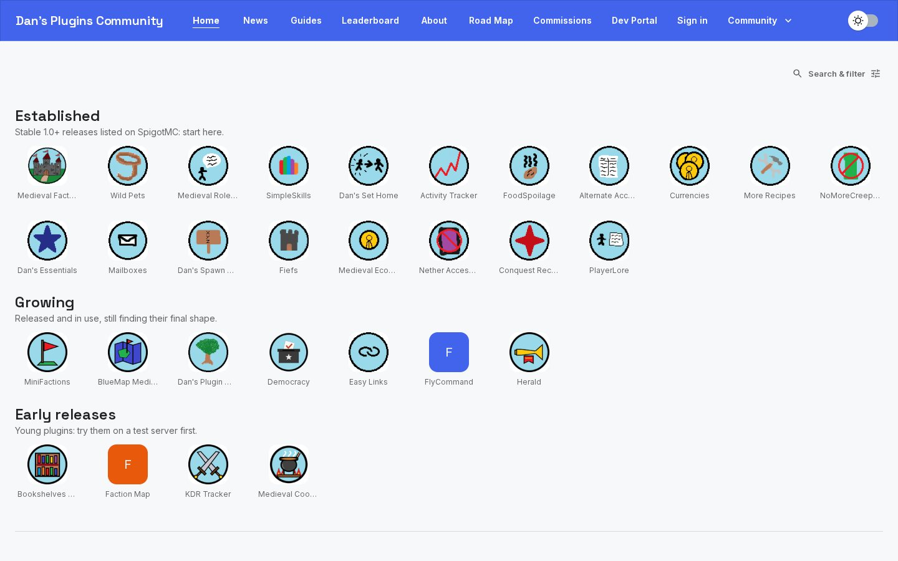</a>
  <a href="docs/images/home-phone.jpg">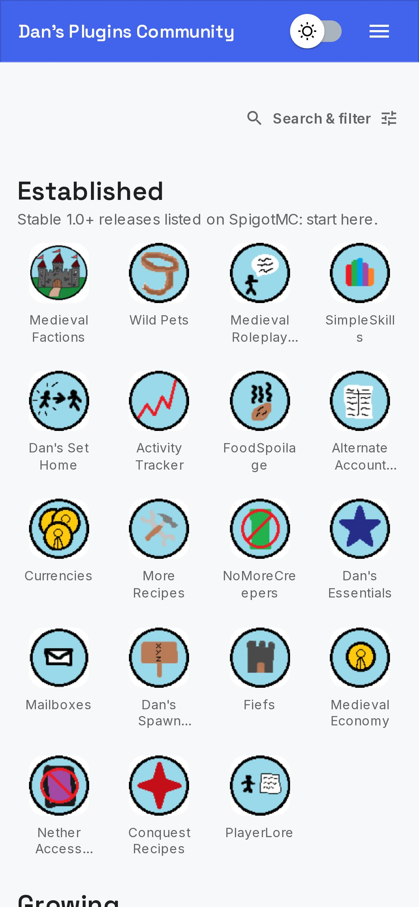</a>

*The home page: every plugin as an icon, sorted into Established, Growing and Early releases. Phone width: four icons a row, navigation behind the menu button.*

## Common Scenarios

### Finding a Plugin

1. Visit the [home page](https://dansplugins.com).
2. Browse the plugin icons displayed on the page, or narrow them down with **Search & filter**, the button above the grid that unfolds the search and filter controls (they unfold by themselves while a filter is active):
   - Type in the **Search plugins…** box to filter by plugin name or description. A "Showing N of M plugins" count appears while a search is active, and the ✕ clears it.
   - Use the **By Popularity** / **Most Liked** / **Most Downloaded** / **Alphabetical** buttons to reorder the plugins within each tier. Popularity is by bStats server count; Most Downloaded is by downloads made through this site.
   - Click a **tag** (admin, factions, survival, …) to show only plugins for that purpose; click it again, or **All**, to clear it. Each plugin's panel lists its own tags, and clicking one there does the same.
   - Pick a **Minecraft version** to show only plugins whose SpigotMC page lists that version as tested. A plugin whose tested versions are not known is left out rather than assumed to work — the answer to "does this run on my server?" is a no, not a guess.
   - Search, tag and version combine, and the search box also matches tags. A "Showing N of M plugins" line appears while any of them is active; if nothing matches, **Clear filters** resets all three.

  <a href="docs/images/home-filter.jpg">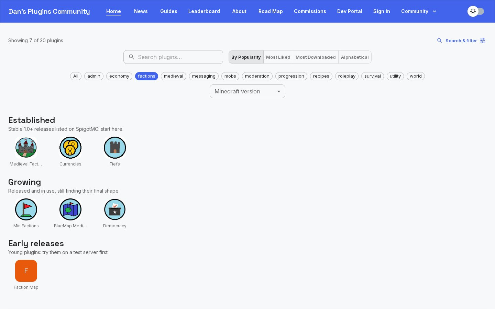</a>

*Search & filter: search box, sort order, tag chips and a Minecraft version picker (here the factions tag is on).*

3. A plugin's panel may carry a few small chips between the description and the buttons, each shown only when the figure behind it is available:
   - **N servers** — how many servers are running the plugin, as reported by bStats. Plugins with no bStats project, or none reporting yet, show no such chip.
   - **Latest: vX.Y.Z** — the plugin's newest release. A plugin that has published no release, or whose releases have not yet been mirrored from GitHub, shows no such chip.
   - **N downloads** — how many times the plugin has been downloaded through this site, once it has been.
   - **MC 1.18–1.20** — the Minecraft versions the plugin has been tested on, as listed on its SpigotMC page. An unbroken run is shown as a range; versions with a gap between them are listed separately, so "1.16, 1.21" means exactly those two. A plugin with no SpigotMC page shows no such chip.
   - **★ 4.7** — the plugin's average rating on SpigotMC, shown once it has at least three reviews there. Hover the chip for the number of reviews. This is SpigotMC's figure, not this site's; the plugin's own page links to the reviews behind it.

   These figures are repeated on the plugin's own page (see below), so there is no need to open it just to read them.
4. Once you have found a plugin, use the buttons in its panel:
   - **Details** — that plugin's own page on this site (see below). On a computer, clicking its icon goes to the same place.
   - **Download** — the latest release's plugin jar, straight from GitHub; the same file Dan's Plugin Manager would install. The button is shown only when the release named by the **Latest** chip attaches a jar, and the file is served by GitHub, not by this site.
   - **Guide** — that plugin's user guide, on this site.
   - **GitHub** — the plugin's source code and releases.
   - **SpigotMC** — the plugin's SpigotMC resource page, shown for plugins that have one.
   - The heart records the plugin in your **My likes** list; you will be prompted to sign in first if you are not already.

  <a href="docs/images/home-panel.jpg">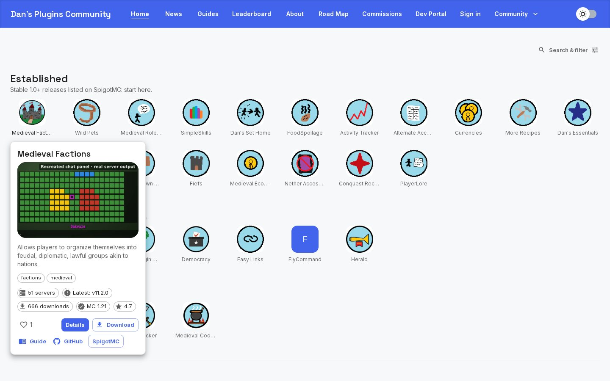</a>
  <a href="docs/images/phone-sheet.jpg">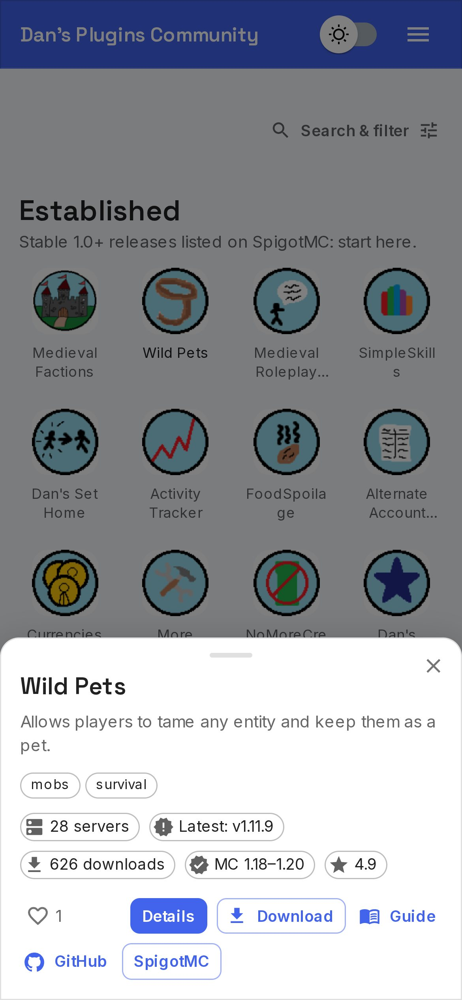</a>

*Hovering an icon opens its panel: preview, description, figures, and Details / Download / Guide / GitHub buttons. On a phone, a tap opens the plugin's details in a sheet at the bottom of the screen.*

5. Most plugins also have a short **preview clip**, a few seconds long, muted and looping, with a pause button. On a computer it plays at the top of the plugin's panel when you hover over its icon or move to it with the keyboard, and stops when the panel closes; nothing is downloaded for it until then. On a phone or tablet a tap opens the plugin's sheet exactly as before, with no clip, and the clip plays on the plugin's page instead (**Details**). If your device is set to reduce motion, you see a still instead, everywhere.

### Viewing a Plugin's Page

1. From the home page, click a plugin's icon or the **Details** button in its panel (or visit `/resources/<plugin>` directly — for example `/resources/medieval-factions`).
2. The page shows the plugin's description, how many servers are running it, its latest release version, how many times its mirrored releases have been downloaded from GitHub, the Minecraft versions it has been tested on, its download count on SpigotMC, and — for plugins with at least three reviews there — their SpigotMC rating, along with the heart to like it. The rating chip opens the reviews on SpigotMC; it is their figure, shown here until this site has reviews of its own. A line beneath states when the plugin was first released and last updated, as its GitHub releases record it; either half is left out when it is not known. The plugin's tags follow its description. Below those, a **Downloads** box counts downloads made through this site the way SpigotMC counts its own: the total across every release, and the latest release's.

  <a href="docs/images/plugin-page.jpg">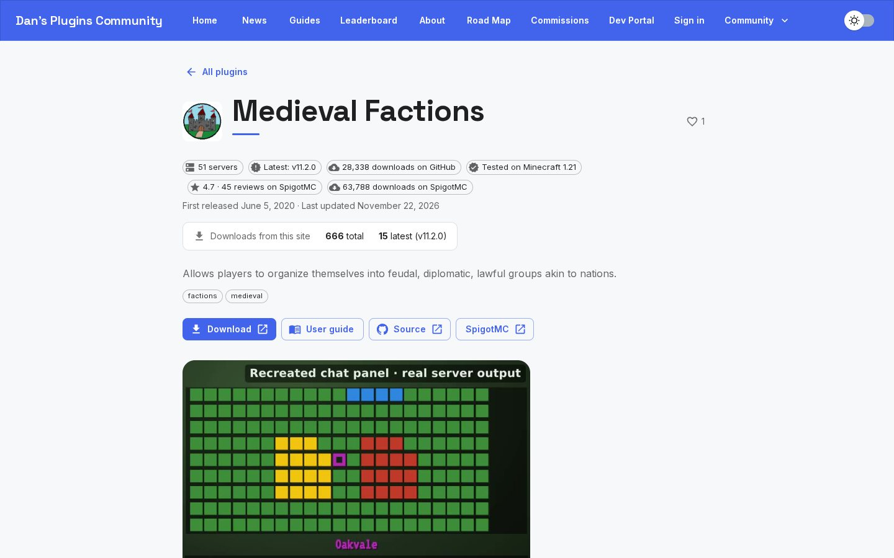</a>

*A plugin's own page: live figures, download counts, tags and links.*

3. Use the buttons to act on it:
   - **Download** — the plugin's releases on GitHub, where its builds are published. The website does not host plugin files itself.
   - **User guide** — the same guide reachable from the Guides page.
   - **Source** — the plugin's source code.
   - **SpigotMC** — its SpigotMC page, for plugins that have one.
4. A plugin with a **preview clip** shows it under the buttons, with a line saying how it was made. Most clips are *recreations* of the in-game chat window: every line in them is the plugin's real output, captured when a test player ran the commands on a test server, redrawn as a chat panel. The Wild Pets and Dan's Spawn System clips show the test server's real world in 3D, as a camera player saw it while a test player used the plugin, with the plugin's chat lines recreated in the corner. The BlueMap Medieval Factions clip is BlueMap's own web map, recorded on a test server. The Medieval Factions page also shows two **world renders** under its clip, each with a caption: example factions' claims over a Minecraft world, and example factions as an archipelago of islands joined by alliances, wars and vassals. Both are drawn in 3D from made-up data, so no real server's factions appear. Like the clips, they are muted, can be paused, and show a still if your device is set to reduce motion.

  <a href="docs/images/plugin-preview.jpg">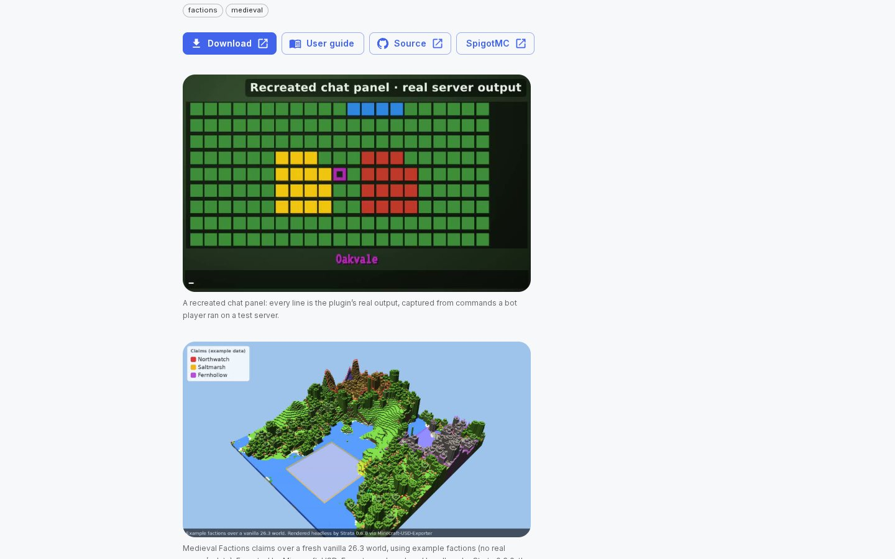</a>

*Preview clips and world renders, captioned with how each was made.*

5. **Usage** shows how much the plugin is in use on real servers over the last 30 days, as reported to [trace](https://trace.danielstephenson.dev): it leads with active servers (30 days) where the plugin reports them, otherwise with when it was last reported in use. Servers are counted only from newer plugin versions, which send a per-server ID, so the real number can be higher; the panel says so. Server starts are shown in small print. Last come the per-day trend charts for the 30 days: active servers per day (drawn once trace reports a per-day server count; it does not yet, so today only starts are drawn) and server starts per day. Each chart is labelled with its first and last day and its peak, and says in words whether the later half of the window is up, down or steady on the earlier half (today, still under way, is left out of that comparison). Its **Usage of every plugin** link opens the `/usage` page (see below). Plugins with no figures yet, or a page rendered while trace could not be reached, show no Usage section.
6. **Verified before release** lists the release checks the plugin's current stable release passed, each linking to its public run, with a **How releases work** link to `/releases` (see below). Releases whose notes record no checks show nothing here.
7. Under **Versions**, the newest release is shown open, with its release notes, how many times it has been downloaded through this site, and a download button for each file it publishes; earlier releases sit below it and expand when clicked. Every download link leads to the file on GitHub — the site only counts the download on the way past. Plugins that have never published a release show no Versions section.

  <a href="docs/images/plugin-versions.jpg">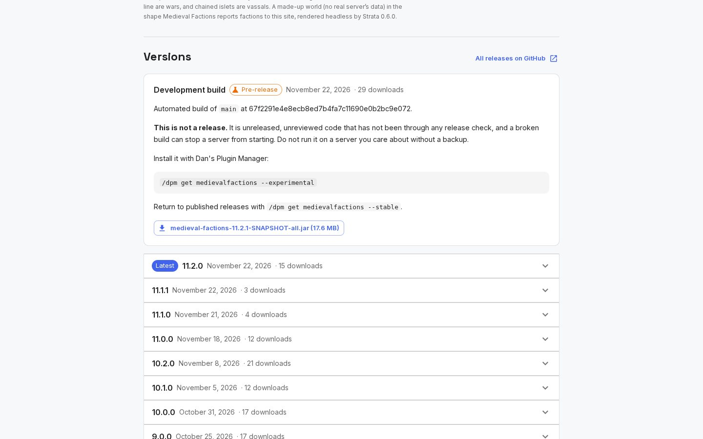</a>

*Versions: a clearly marked development build, then every release with its date and download count; each row expands to its notes and files.*

8. **Expansions** lists the plugins that cannot run without this one, such as the Medieval Factions add-ons; each add-on's own page says which plugin it requires, with a link back.
9. **Related plugins** lists the plugins that share a tag with this one, those with the most in common first — Currencies and Fiefs both extend Medieval Factions, for instance, and each names the other here. A plugin already listed under Expansions is not repeated. Plugins sharing no tag with anything show no such section.
10. At the bottom, **Report a bug** opens a new issue on that plugin's issue tracker, and **Suggest a feature** goes to the Dev Portal, where ideas can be submitted and upvoted.

### Reading the Latest News

1. Click **News** in the top navigation bar (or visit `/news`).
2. Browse the posts, shown newest first.

  <a href="docs/images/news.jpg">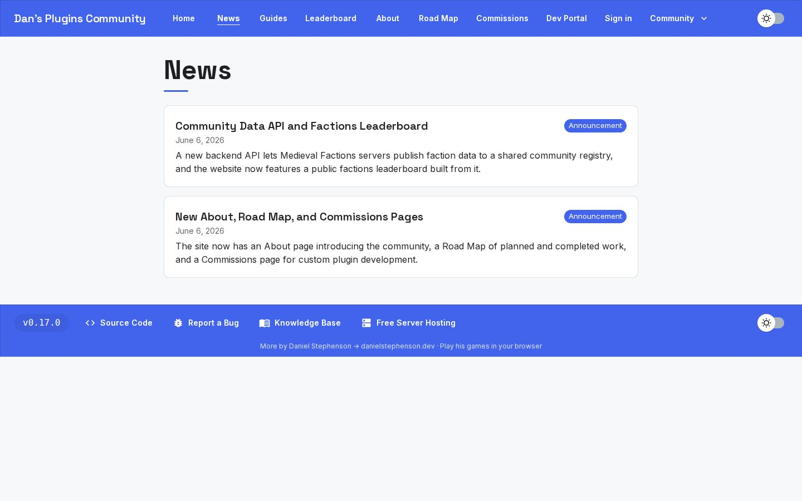</a>

*News, newest first.*

### Browsing Plugin Guides

1. Click **Guides** in the top navigation bar (or visit `/guides`).
2. Select a plugin from the list to open that plugin's user guide on-site (with a "View on GitHub" link if you want the raw source).
3. A guide often links to the plugin's other documents, such as its command or configuration reference. Those live in the plugin's repository, so they open on GitHub in a new tab; links within the same guide jump down the page as usual.

  <a href="docs/images/guides.jpg">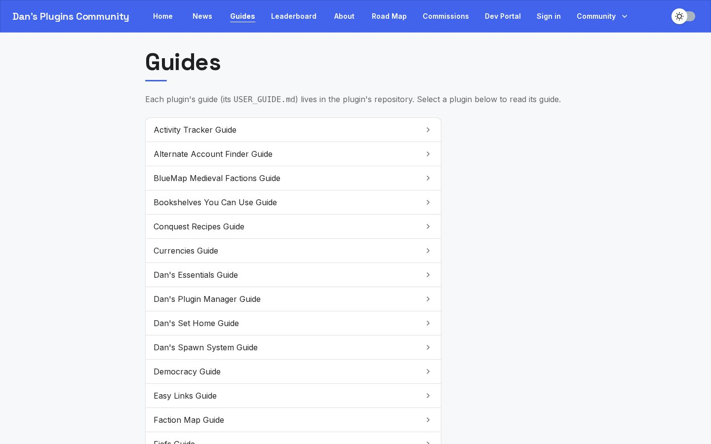</a>
  <a href="docs/images/guide-page.jpg">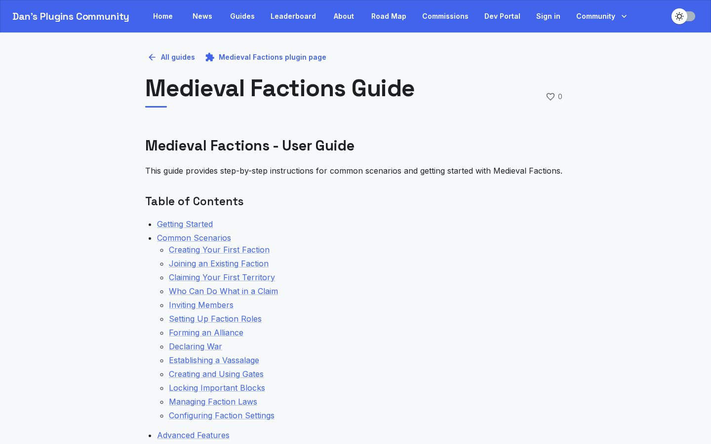</a>

*Guides: every plugin's user guide, read on-site. A plugin guide, rendered on-site from its repository.*

### Viewing the Faction Leaderboard

1. Click **Leaderboard** in the top navigation bar (or visit `/leaderboard`).
2. Review the factions, ranked by number of members across all servers.

  <a href="docs/images/leaderboard.jpg">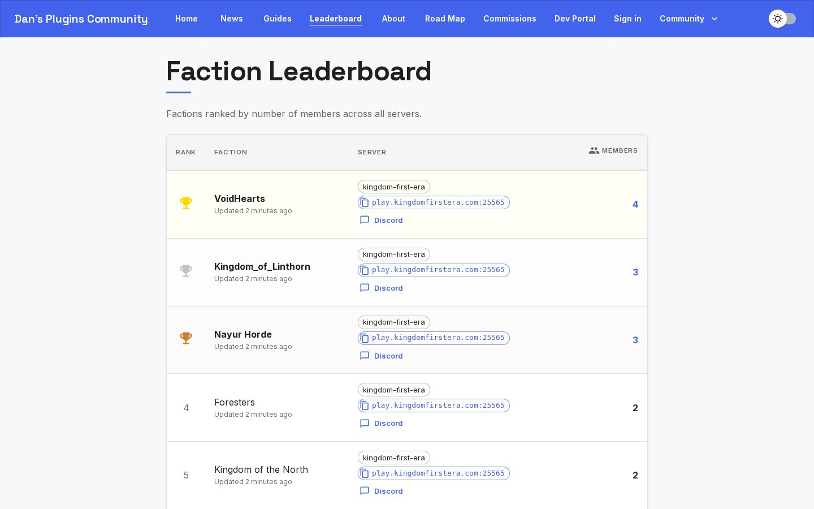</a>

*The faction leaderboard, built from data Medieval Factions servers publish.*

### Learning About the Community

1. Click **About** in the top navigation bar (or visit `/about`).
2. Read the overview of Dan's Plugins Community.
3. Use the GitHub, Discord, or Patreon links to get involved.

  <a href="docs/images/about.jpg">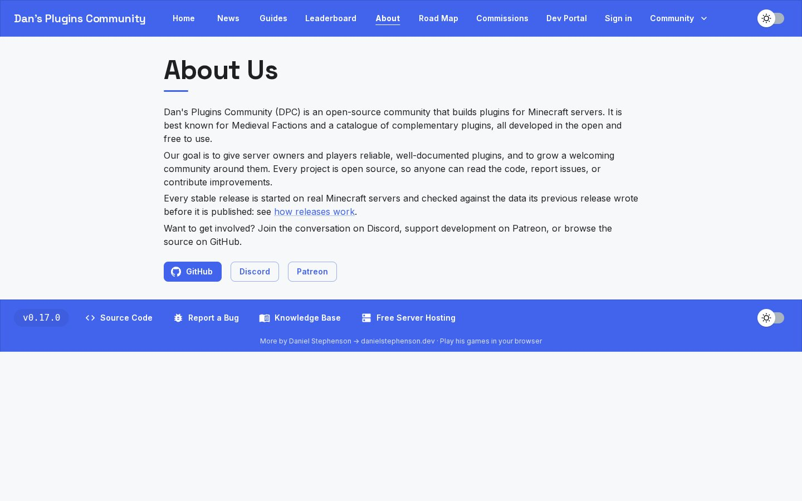</a>

*About the community, with GitHub, Discord and Patreon links.*

### Viewing the Roadmap

1. Click **Roadmap** in the top navigation bar (or visit `/roadmap`).
2. Review the planned, in-progress, and completed work.
3. Follow the linked GitHub issue tracker for day-to-day detail.

  <a href="docs/images/roadmap.jpg">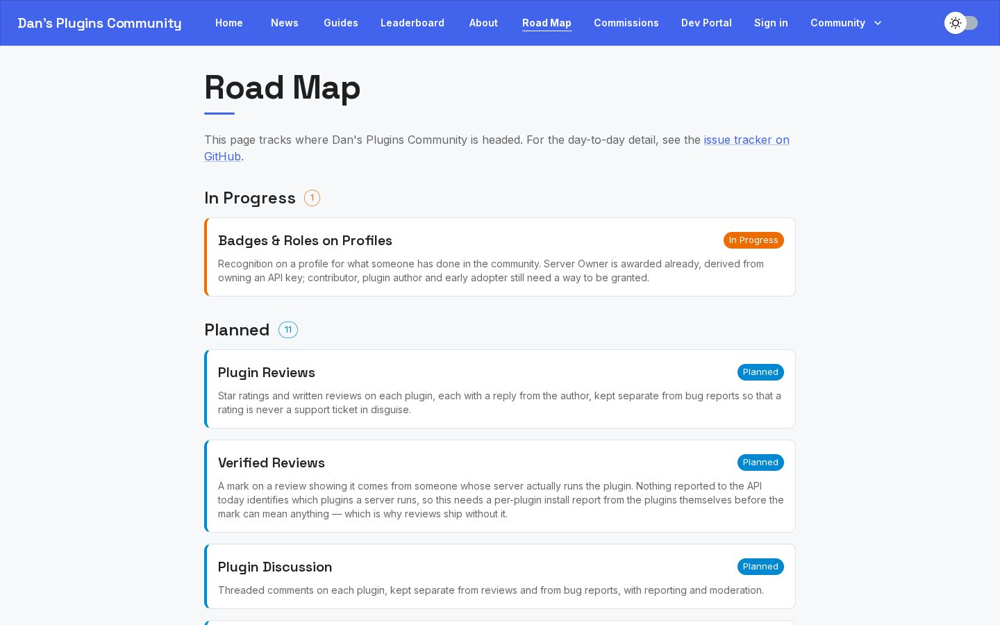</a>

*The road map: planned, in-progress and completed work.*

### Following Development in the Dev Portal

1. Click **Dev Portal** in the top navigation bar (or visit `/dev`).
2. Review every open issue and pull request across the Dans-Plugins GitHub organization in one place: totals at the top, a row per repository, and the open items themselves, which can be narrowed by repository and type. The view is a mirror that refreshes on a schedule; GitHub stays the source of truth.
3. Once signed in, use the heart in an item's **Interested** column to show you want it done, or **I'm working on this** in its **Claimed** column so nobody duplicates your work. Everyone sees who has claimed an item; **Release** gives your claim back, and a claim is released automatically after thirty days.
4. Under **Feature requests**, submit an idea for a plugin or upvote someone else's. A plugin page's **Suggest a feature** button leads here. An admin can turn a wanted idea into a real GitHub issue, and the idea then links to it.

  <a href="docs/images/dev-portal.jpg">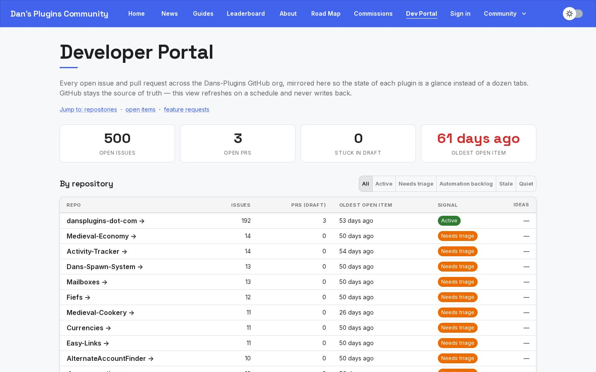</a>

*The Dev Portal: every open issue and pull request across the organization at a glance.*

### Checking Plugin Usage

1. Visit `/usage`, or follow **Usage of every plugin** from a plugin page's Usage section.
2. Review how many servers run each plugin, as reported to trace: active servers in the last 30 days and servers seen in the past year. Servers are counted only from newer plugin versions, which send a per-server ID, so these figures are minimums. A plugin with no server count shows when it was last reported in use. Server starts appear in small print only: a server start is not a server, since one server restarting every night counts thirty times. Plugins are listed by active servers, then servers seen in the past year, then how recently they were reported. Each row has a small trend chart of server starts per day (with active servers per day above it once trace reports them), captioned with whether it is up, down or steady; a screen reader hears the chart's range, total, peak and change.
3. If trace cannot be reached, the page says the figures are unavailable rather than showing none.

  <a href="docs/images/usage.jpg">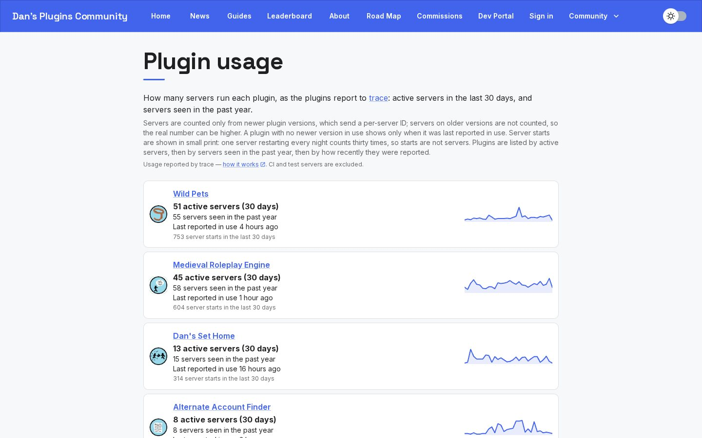</a>

*Plugin usage: active servers per plugin, with a 30-day trend for each.*

### Learning How Releases Are Checked

1. Visit `/releases`, or follow **How releases work** from the About page or a plugin page's **Verified before release** section.
2. Read what the release gates check before a stable release is published, the difference between the stable and dev channels, which Minecraft versions are supported, and what happens when a check fails or a release has to be pulled.

  <a href="docs/images/releases.jpg">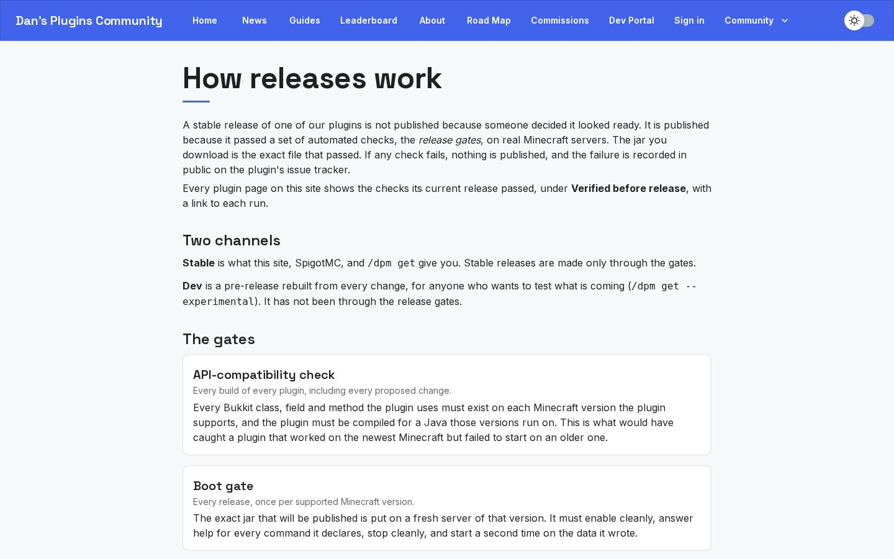</a>

*How releases work: the two channels and the gates a stable release must pass.*

### Requesting a Commission

1. Click **Commissions** in the top navigation bar (or visit `/commissions`).
2. Review the pricing options, what's included, and the current availability status.
3. Click **Join the Commissions Discord** to discuss your project.

  <a href="docs/images/commissions.jpg">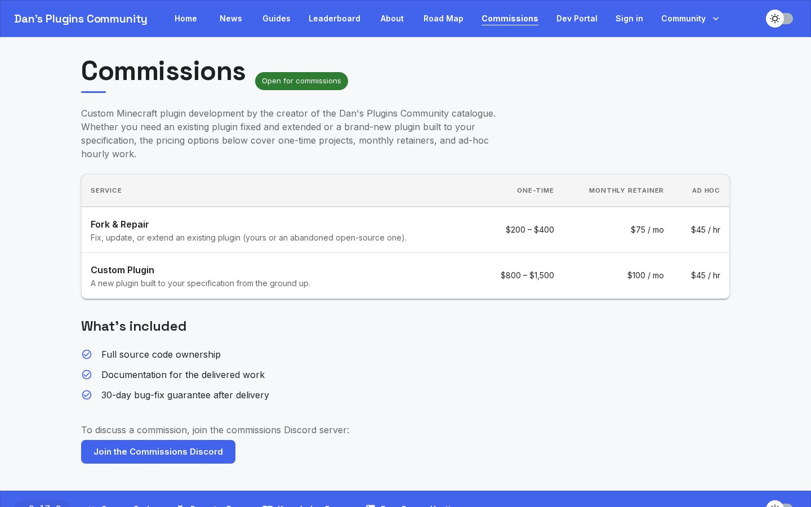</a>

*Commissions: pricing, what is included and availability.*

### Managing Your Account

1. Click **Sign in** in the top navigation bar (or visit `/account`). Once you are signed in, the same link shows your username instead.
2. Register a new account, or log in with an existing username and password. You stay signed in on that browser for up to thirty days: the site renews its session in the background, and only a logout (or a password reset) ends it sooner.
3. Once logged in, create or delete the API keys used to connect a server to the DPC community data API.
4. The **My likes** section lists the plugins and guides you've liked, linking to each one — your personal toolbox.
5. Click **View your public profile** to see your profile as other people see it (display name, avatar, bio, join date, badges, and likes). Anyone can view a user's public profile at `/u/<username>`. Badges are earned automatically — for example, **Server Owner** appears once you have created an API key for a server.

  <a href="docs/images/account.jpg">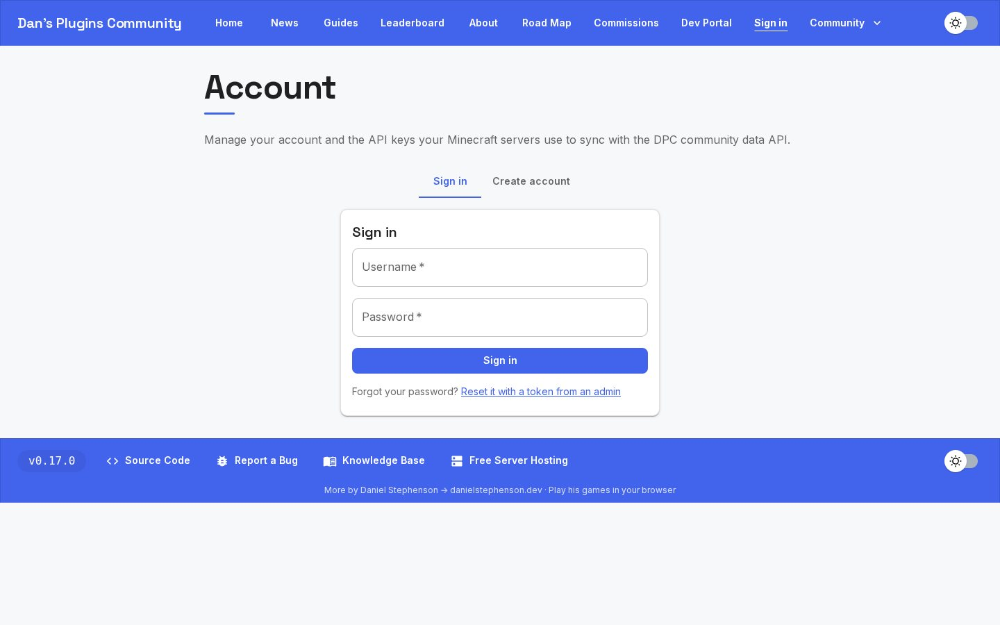</a>

*Sign in or create an account (for likes, API keys and a public profile).*

### Resetting a Forgotten Password

The site sends no email, so a password reset starts with an admin rather than a form: ask on the community Discord, and once the admin has confirmed it is you, they issue a one-time reset token — usually as a link straight to `/account/reset` with the token filled in. The token works once and for thirty minutes.

1. Open the link (or visit `/account/reset` and paste the token — the login form's **Forgot your password?** points there).
2. Choose a new password (8–128 characters with a lowercase letter, an uppercase letter, a digit and a special character) and confirm it.
3. **Set new password.** Every session on the account is signed out, this one included, so the next step is signing in with the new password.

Admins issue tokens on the server, not on the site — see `dpc-api/README.md` and the UserAuth README's `POST /password/reset/issue`.

### Editing the Plugin Catalogue (admins)

The catalogue — every plugin's title, description, links, icon and tags — lives in the community API and is edited on the site, not by pull request.

1. Sign in with **Sign in** in the top navigation bar (or at `/account`). If your account is one the API lists as an admin (`DPC_ADMIN_USERNAMES` on the server), a notice on the account page (`/account`, the signed-in username in the navigation bar) links to **Edit the plugin catalogue**; the page is also at `/admin/plugins`.
2. Pick a plugin from the list to edit it, or **Add a plugin**. A new plugin's **slug** becomes its URL (`/resources/<slug>`, `/guides/<slug>`) and cannot be changed afterwards; everything else can.
3. Fill in the fields — the GitHub repository is required, the SpigotMC URL, bStats id and icon path are optional, and **Tags** is a comma-separated list of short lower-case words (the tag filter on the home page is built from whatever tags are in use). An icon path names a file under `public/icons` in the website repository, so a new icon still ships with the site.
4. **Save changes** (or **Add plugin**). The API checks the fields and refuses anything malformed with a message on the field; a slug already in use is refused too. The public pages show the change on their next render — within five minutes for a page that had it cached.

Removing a plugin is not offered: its mirrored versions, download counts and likes all hang off the row, so that stays a deliberate change made in the API repository. Anyone who is not an admin sees the page but the API refuses every change, and the page says so.

### Getting Support

If you need help with any DPC plugin, join the community Discord:

1. Click the Discord link displayed on the site or visit [https://discord.gg/xXtuAQ2](https://discord.gg/xXtuAQ2).
2. Browse the relevant plugin channel.
3. Ask your question.

### Reporting a Website Bug

If you find a bug on the website itself:

1. Go to the [GitHub Issues page](https://github.com/Dans-Plugins/dansplugins-dot-com/issues).
2. Click **New Issue**.
3. Describe the problem and include steps to reproduce it.
